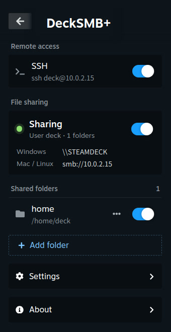
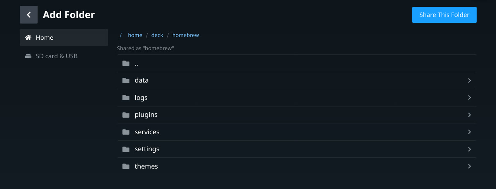
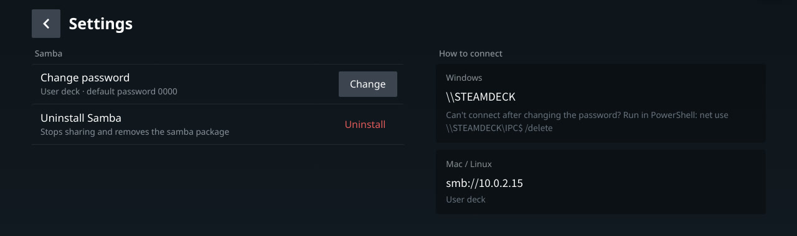
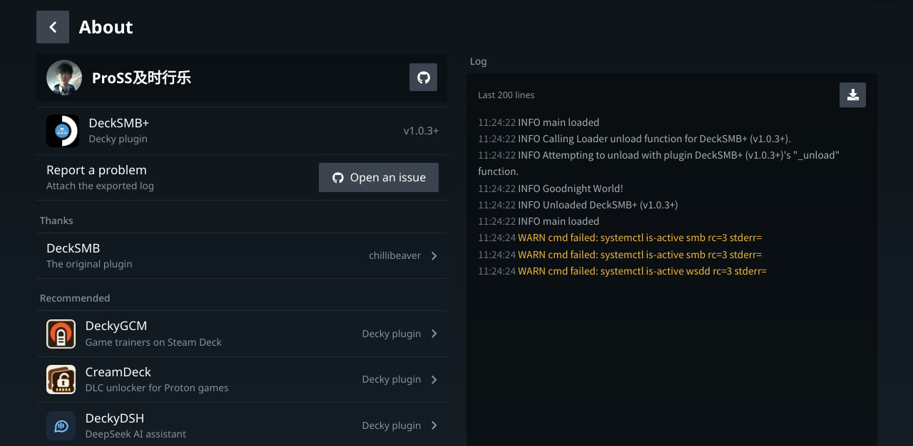

<h1 align="center">
  
  <br>
  DeckSMB+
  </br>
</h1>

<p align="center">
  <a href="https://github.com/Qiming-Liu/DeckSMBx/releases"></a>
</p>

A [Decky Loader](https://decky.xyz/) plugin to set up a Samba/SMB server on Steam Deck for file sharing, and to turn SSH on or off — all from Game Mode.

DeckSMB+ is a fork of [DeckSMB](https://github.com/bonorca/DeckSMB) by chillibeaver.

[中文](README_cn.md)

## Features



- **SSH switch** — turn the SSH server on or off; works without Samba
- **One-click Samba setup** — install and uninstall, with progress by step
- **Start / Stop** — SMB service with a toggle; the Windows and Mac addresses are shown
- **Manage shared folders** — add, pause, resume and remove shares, with undo



Pick a folder to share from your home folder or an SD card / USB drive.



**Settings:** change the Samba password, uninstall Samba, and see how to connect from Windows and Mac / Linux.



**About:** version, feedback, recommended plugins, and the plugin's live log with an export button.

## Quick Start

1. Download the ZIP from [Releases](https://github.com/Qiming-Liu/DeckSMBx/releases)
2. In Decky Loader, go to **Settings** → **General** → enable **Developer Mode**
3. Go to the **Developer** tab → **Install Plugin from ZIP**
4. Open the plugin and click **Install Samba**
5. Access your Steam Deck from another device:
   - It should appear in File Explorer under Network
   - If not, try `\\STEAMDECK` on Windows or `smb://steamdeck.local` on Mac / Linux

> [!IMPORTANT]
> **Default credentials:** \
> Username: `deck` \
> Password: `0000`

> **Note:** SteamOS updates will remove Samba due to its immutable filesystem. You will need to reinstall after each system update. Your shares and password will be preserved.

### Coming from DeckSMB

Uninstall the original DeckSMB first. On its first start, DeckSMB+ takes over DeckSMB's shared folders and Samba password.

### SSH

The **SSH** switch starts the SSH server and keeps it on after a restart. The panel then shows the address to use, e.g. `ssh deck@192.168.1.20`.

SteamOS gives the `deck` user no password, and SSH needs one to log in. DeckSMB+ does not set it (the Samba password is separate). Set it once in Desktop Mode: open Konsole and run `passwd`.

### After changing the Samba password

Samba won't disconnect you immediately after changing your password. To see the change take effect, toggle the SMB service once, and the new credentials will be required.

Windows caches SMB credentials. If you change your Samba password, Windows will still try the old one and fail with "access denied". To fix this, open CMD or PowerShell and run:
```cmd
net use
```
Find the entry for your Steam Deck (e.g. `\\STEAMDECK\IPC$`) and delete it:
```cmd
net use \\STEAMDECK\IPC$ /delete
```
Then reconnect and enter the new password.

## Feedback

Feel free to open an [issue](https://github.com/Qiming-Liu/DeckSMBx/issues/new) if you encounter any problems. Please go to **About** → **Log** in the plugin and press the export button first and attach the file from `~/Downloads`.

## License

MIT. Based on [DeckSMB](https://github.com/bonorca/DeckSMB) © 2026 chillibeaver.
