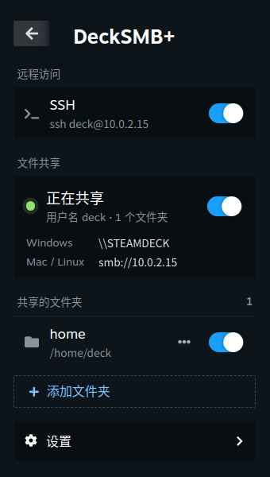

<h1 align="center">
  
  <br>
  DeckSMB+
  </br>
</h1>

<p align="center">
  <a href="https://github.com/Qiming-Liu/DeckSMBx/releases"></a>
</p>

一个 [Decky Loader](https://decky.xyz/) 插件，用于在 Steam Deck 上搭建 Samba/SMB 服务器以实现文件共享，并能开关 SSH——全程在游戏模式下完成。

DeckSMB+ fork 自 chillibeaver 的 [DeckSMB](https://github.com/bonorca/DeckSMB)。

[English](README.md)

## 功能

<p align="center">
  
</p>

- **SSH 开关** — 打开或关闭 SSH 服务，不装 Samba 也能用
- **一键安装 Samba** — 自动安装/卸载，按步骤显示进度
- **启动 / 停止** — 通过开关切换 SMB 服务，并显示 Windows 和 Mac 的连接地址
- **管理共享文件夹** — 添加、暂停、恢复和移除共享，移除后可撤销

## 安装

1. 从 [Release](https://github.com/Qiming-Liu/DeckSMBx/releases) 下载 ZIP 文件
2. 在 Decky Loader 中，进入 **设置** → **通用** → 启用 **开发者模式**
3. 进入 **开发者** 选项卡 → **从 ZIP 安装插件**
4. 打开插件并点击 **安装 Samba**
5. 从其他设备访问你的 Steam Deck：
   - 应该会出现在文件资源管理器的"网络"中
   - 如果没有，Windows 上试试 `\\STEAMDECK`，Mac / Linux 上试试 `smb://steamdeck.local`

**默认凭据：**
- 用户名：`deck`
- 密码：`0000`

> **注意：** 由于 SteamOS 采用不可变文件系统，系统更新会移除 Samba。每次系统更新后需要重新安装。你的共享配置和密码将会保留。

### 从 DeckSMB 迁移

先卸载原版 DeckSMB。DeckSMB+ 第一次启动时会接管 DeckSMB 的共享文件夹和 Samba 密码。

### SSH

**SSH** 开关会启动 SSH 服务，重启后也保持开启。打开后面板会显示连接地址，比如 `ssh deck@192.168.1.20`。

SteamOS 默认没有给 `deck` 用户设密码，而 SSH 登录需要密码。DeckSMB+ 不负责设置它（Samba 密码是另一回事）。请在桌面模式打开 Konsole，运行一次 `passwd` 设好密码。

### 更改 Samba 密码后

按照设计，更改密码后 Samba 不会立即断开你的连接。要使更改生效，请切换一次 SMB 服务开关，之后将要求使用新凭据。

Windows 会缓存 SMB 凭据。如果你更改了 Samba 密码，Windows 仍会尝试使用旧密码，导致"访问被拒绝"。要解决此问题，请打开 CMD 或 Powershell 并运行：

```cmd
net use \\STEAMDECK\IPC$ /delete
```

然后重新连接并输入新密码。

### 访问被拒绝？

- 用户名填 `deck`，不支持访客 / 匿名登录。
- 如果从很旧的 DeckSMB（1.0.1 及更早）迁移过来，默认密码可能没设上，在 **设置** 里 **修改密码** 一次即可。
- macOS：选择 **注册用户**，不要选访客。
- Windows：按上面的方法清除缓存的凭据。

## 反馈

如果遇到任何问题，欢迎提交 [issue](https://github.com/Qiming-Liu/DeckSMBx/issues/new)。请先在插件 **设置** → **关于** 里点日志上方的导出按钮，并附上 `~/Downloads` 里生成的文件。

## 许可证

MIT。基于 [DeckSMB](https://github.com/bonorca/DeckSMB) © 2026 chillibeaver。
